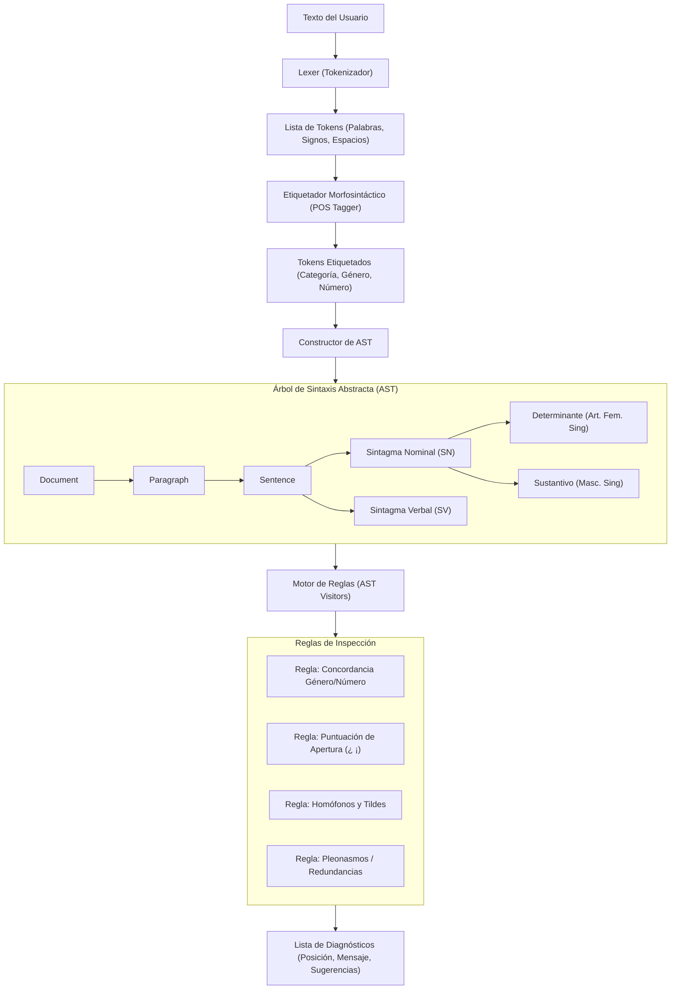

# ✍️ GramatiGo — Corrector Ortográfico y Gramatical en Español

> Aplicación de escritorio nativa para Windows y Linux, desarrollada en **Golang**, diseñada bajo principios **YAGNI, DRY, KISS, SOLID, VSA (Vertical Slice Architecture)** y motor de reglas basado en **AST (Abstract Syntax Tree)**.

---

## 📑 Tabla de Contenidos

1. [Análisis de Viabilidad: ¿Es viable en Golang?](#-análisis-de-viabilidad-es-viable-en-golang)
   - [Comparativa: Golang vs. Python vs. TypeScript](#comparativa-golang-vs-python-vs-typescript)
   - [Elección de la Interfaz Gráfica (GUI)](#elección-de-la-interfaz-gráfica-gui)
2. [Arquitectura del Sistema](#-arquitectura-del-sistema)
   - [Principios Aplicados (YAGNI, DRY, KISS, SOLID)](#principios-aplicados)
   - [VSA (Vertical Slice Architecture)](#vsa-vertical-slice-architecture)
   - [Motor Lingüístico basado en AST](#motor-lingüístico-basado-en-ast)
3. [Estructura del Proyecto](#-estructura-del-proyecto)
4. [Estrategia de Control de Versiones y Commits Atómicos](#-estrategia-de-control-de-versiones-y-commits-atómicos)
5. [Paso a Paso de Implementación (Roadmap)](#-paso-a-paso-de-implementación-roadmap)
6. [Guía de Ejecución y Compilación](#-guía-de-ejecución-y-compilación)
   - [Requisitos Previos](#requisitos-previos)
   - [Ejecución en Windows (PowerShell)](#ejecución-en-windows-powershell)
   - [Ejecución en Linux (Bash)](#ejecución-en-linux-bash)

---

## 🔍 Análisis de Viabilidad: ¿Es viable en Golang?

### **Conclusión: SÍ, ES 100% VIABLE Y ALTAMENTE RECOMENDADO.**

Golang es una elección sobresaliente para un corrector ortográfico y gramatical de escritorio nativo por las siguientes razones:

1. **Rendimiento y Baja Latencia:** El análisis ortográfico y sintáctico ocurre en microsegundos. El usuario puede escribir en tiempo real sin experimentar retrasos ni bloqueos en la interfaz.
2. **Binario Nativo Único:** Go compila a código de máquina puro (`.exe` en Windows y binario ELF en Linux) sin necesidad de que el usuario final instale intérpretes ni runtimes pesados.
3. **Bajo Consumo de Memoria:** Consume entre 30 MB y 70 MB de RAM, en contraste con aplicaciones basadas en Electron que superan fácilmente los 300 MB.
4. **Concurrencia Nativa (Goroutines):** El motor lingüístico ejecuta el parseo de AST y las reglas de validación en segundo plano mientras el hilo de la UI permanece 100% fluido a 60 FPS.

---

### Comparativa: Golang vs. Python vs. TypeScript

| Criterio | **Golang** (Recomendado) | **Python** (Alternativa 1) | **TypeScript / Electron** (Alternativa 2) |
| :--- | :--- | :--- | :--- |
| **Distribución / Ejecutable** | ⭐⭐⭐⭐⭐ Binario nativo único (`.exe` o Linux ELF) sin dependencias. | ⭐⭐ PyInstaller / cx_Freeze generan carpetas pesadas (+150MB) y sufren falsos positivos de antivirus. | ⭐⭐⭐ Electron genera instaladores enormes (+120MB) con un Chromium embebido. |
| **Consumo de Memoria** | ⭐⭐⭐⭐⭐ Muy bajo (~35-65 MB). | ⭐⭐⭐ Medio (~90-180 MB). | ⭐ Alto (+250-450 MB). |
| **Velocidad de Análisis** | ⭐⭐⭐⭐⭐ Milisegundos gracias al tipado estático y compilación nativa. | ⭐⭐⭐ Lento en bucles de tokens si no usa extensiones C/Cython. | ⭐⭐⭐ Rápido con motor V8, pero inferior a Go. |
| **Ecosistema de NLP** | ⭐⭐⭐ Requiere estructurar el AST y diccionario propio o adaptado. | ⭐⭐⭐⭐⭐ Amplio (spaCy, NLTK, LanguageTool). | ⭐⭐⭐ Bibliotecas ligeras como compromise o nlp.js. |
| **Calidad de UI** | ⭐⭐⭐⭐⭐ Con **Wails v2** se obtiene UI moderna (idéntica a la web) con backend Go nativo. | ⭐⭐ Tkinter es anticuado; PyQt es pesado y con licencias GPL/comerciales restrictivas. | ⭐⭐⭐⭐⭐ Interfaz web moderna, pero sacrificando recursos. |

---

### Elección de la Interfaz Gráfica (GUI)

Para lograr una **"buena interfaz gráfica"** con la experiencia de los correctores web modernos (subrayado ondeado rojo para ortografía, amarillo/azul para gramática, tarjetas emergentes de sugerencias al hacer clic, recuento de palabras y modo oscuro), la combinación óptima es:

* **Wails v2 (Go Backend + WebView nativo de Windows/Linux):**
  - **Windows:** Utiliza el motor WebView2 ya integrado en Windows 10/11 (cero peso extra).
  - **Linux:** Utiliza WebKitGTK nativo.
  - **Frontend:** HTML5, CSS moderno (Tailwind CSS) y JavaScript/TypeScript vanilla o Svelte (ultra liviano).
  - **Backend:** 100% Go con llamadas directas por IPC binario bidireccional.
  - **Resultado:** Un solo archivo ejecutable `.exe`, inicio instantáneo y diseño visual de primer nivel idéntico al corrector web que ya utilizas.

*(Nota: Alternativas como Fyne son 100% Go pero carecen de componentes nativos avanzados de edición de texto enriquecido con subrayados de colores por rangos y popups contextuales fluidos).*

---

## 🏛 Arquitectura del Sistema

### Principios Aplicados

* **YAGNI (You Aren't Gonna Need It):** No se implementan bases de datos externas, servidores en la nube ni microservicios. Todo el pipeline se procesa localmente en memoria.
* **DRY (Don't Repeat Yourself):** Reutilización de estructuras centrales (`Token`, `Span`, `Diagnostic`, `Suggestion`) entre todas las reglas y el frontend.
* **KISS (Keep It Simple, Stupid):** Estructuras limpias, métodos concisos y un flujo de datos unidireccional y predecible:  
  `Texto Plano` ➔ `Lexer` ➔ `POS Tagger` ➔ `AST Parser` ➔ `Rules Runner` ➔ `Diagnósticos / UI`.
* **SOLID:**
  - **S (Single Responsibility):** Cada regla gramatical u ortográfica inspecciona un único aspecto (ej: concordancia de género, signos interrogativos de apertura, tildes diacríticas).
  - **O (Open/Closed):** Nuevas reglas gramaticales se incorporan implementando la interfaz `Rule` sin modificar el motor de ejecución.
  - **L (Liskov Substitution):** Cualquier implementación de `Rule` puede ser ejecutada indistintamente por el `Engine`.
  - **I (Interface Segregation):** Interfaces pequeñas y específicas (`Tokenizer`, `Dictionary`, `GrammarRule`, `Reporter`).
  - **D (Dependency Inversion):** El motor no depende de reglas concretas, sino de la abstracción `Rule`.

---

### VSA (Vertical Slice Architecture)

En lugar de capas horizontales tradicionales (controladores, servicios, repositorios), el código se organiza en **rebanadas verticales (slices)** autónomas agrupadas por funcionalidad de negocio:

```
internal/
├── core/                       # Dominio compartido y modelos transversales
│   ├── ast/                    # Nodos del AST (Document, Paragraph, Sentence, Phrase)
│   ├── token/                  # Definición de tokens, tipos y posiciones
│   └── diagnostic/             # Errores, severidad, spans y sugerencias
│
└── features/                   # Rebanadas verticales (Vertical Slices)
    ├── spellcheck/             # SLICE 1: Corrección ortográfica
    │   ├── dictionary.go       # Carga de léxico y lemas en español
    │   ├── distance.go         # Algoritmo de distancia (Damerau-Levenshtein / SymSpell)
    │   └── spellcheck.go       # Servicio y regla de ortografía
    │
    ├── grammar/                # SLICE 2: Corrección gramatical (Motor AST)
    │   ├── agreement/          # Concordancia género y número (ej. "la problema", "los perro")
    │   ├── typography/         # Puntuación española (¿?, ¡!, espacios ante comas)
    │   ├── diacritics/         # Tildes diacríticas y homófonos (porque/por qué, etc.)
    │   └── rule.go             # Interfaz común de reglas AST
    │
    ├── parser/                 # SLICE 3: Tokenización y construcción del AST
    │   ├── lexer.go            # Segmentador de palabras y signos
    │   ├── tagger.go           # Asignación morfosintáctica (POS Tagger)
    │   └── ast_builder.go      # Ensamblador de Sintagmas (SN, SV) y Oraciones
    │
    └── statistics/             # SLICE 4: Métricas del documento
        └── metrics.go          # Contador de palabras, caracteres, legibilidad (Flesch-Szigriszt)
```

---

### Motor Lingüístico basado en AST

El procesamiento del español se estructura en un **Árbol de Sintaxis Abstracta (AST)**:



---

## 📂 Estructura del Proyecto

```
CorrectorOrtografico/
├── .git/                       # Repositorio Git inicializado
├── .gitignore                  # Archivos ignorados (binarios, temporales)
├── README.md                   # Este documento explicativo
├── go.mod                      # Módulo de Go
├── go.sum                      # Checksums de dependencias
├── wails.json                  # Configuración de la aplicación de escritorio Wails
├── scripts/                    # Harness de automatización
│   ├── commit.ps1              # Script para commits atómicos guiados (Windows)
│   ├── commit.sh               # Script para commits atómicos guiados (Linux)
│   ├── run.ps1                 # Script de ejecución rápida en Windows
│   ├── run.sh                  # Script de ejecución rápida en Linux
│   ├── build.ps1               # Compilación a .exe nativo en Windows
│   └── build.sh                # Compilación a binario nativo en Linux
├── assets/                     # Diccionarios de español y recursos embebidos
│   └── dict/
│       ├── es_ES.words         # Léxico base en español con frecuencias
│       └── rules_es.json       # Definición declarativa de reglas y patrones
├── frontend/                   # Interfaz de usuario (HTML/CSS/JS + Tailwind)
│   ├── index.html              # Lienzo principal del editor de texto
│   ├── src/
│   │   ├── app.css             # Estilos de subrayado ondeado y tarjetas emergentes
│   │   └── main.js             # Lógica de renderizado y comunicación con Go
│   └── package.json
└── internal/                   # Código Go estructurado en Vertical Slices
    ├── app/                    # Coordinador de la aplicación y bindings Wails
    ├── core/                   # Modelos de AST, Token y Diagnostic
    └── features/               # Rebanadas de ortografía, gramática y parser
```

---

## 🚦 Estrategia de Control de Versiones y Commits Atómicos

### Reglas del Harness de Git

1. **Idioma de los Commits:** Exclusivamente en **inglés**.
2. **Formato Convencional (Conventional Commits):**  
   `<type>(<scope>): <short imperative description>`
   - `feat`: Nueva característica o regla de validación.
   - `fix`: Corrección de un fallo o falso positivo lingüístico.
   - `refactor`: Mejora de código sin alterar el comportamiento.
   - `test`: Incorporación o mejora de pruebas unitarias.
   - `docs`: Documentación o cambios en el README.
   - `chore`: Configuración, scripts de build o dependencias.
3. **Atomicidad:** Cada commit debe representar un cambio único, coherente y funcional, garantizando que el proyecto compile y pase las pruebas en cada punto de la historia.

---

## 🗺 Paso a Paso de Implementación (Roadmap)

### **Fase 0: Harness Inicial y Configuración del Repositorio**
- [ ] Inicializar Git y configurar `.gitignore` para Go, Node y entornos Windows/Linux.
- [ ] Crear el módulo Go (`go mod init corrector-ortografico`).
- [ ] Crear los scripts de conveniencia: `scripts/run.ps1`, `scripts/run.sh`, `scripts/build.ps1`, `scripts/build.sh`.
- [ ] Implementar el script de validación de commits atómicos (`scripts/commit.ps1`).

### **Fase 1: Capa Central y Modelado del AST (Abstract Syntax Tree)**
- [ ] Definir los tipos de datos en `internal/core/token` (`Token`, `TokenType`, `Span`).
- [ ] Diseñar el modelo de AST en `internal/core/ast` (`Document`, `Paragraph`, `Sentence`, `Phrase`, `WordNode`).
- [ ] Crear el modelo de diagnósticos en `internal/core/diagnostic` (`Diagnostic`, `Severity`, `Suggestion`).
- [ ] Escribir pruebas unitarias para la serialización y recorrido de nodos del AST.

### **Fase 2: Slice de Tokenización y Parsing del Español**
- [ ] Implementar el `Lexer` en Go para segmentar palabras en español con soporte para caracteres Unicode (á, é, í, ó, ú, ü, ñ, ¿, ¡).
- [ ] Diseñar el `Tagger` morfosintáctico básico (identificación de determinantes, sustantivos, adjetivos, verbos, pronombres y preposiciones).
- [ ] Construir el `ASTBuilder` que agrupa tokens en oraciones y sintagmas (Nominal y Verbal).
- [ ] Pruebas unitarias para oraciones compuestas y casos de puntuación.

### **Fase 3: Slice de Corrección Ortográfica (Spellcheck)**
- [ ] Integrar el diccionario base de frecuencias del español en `assets/dict/`.
- [ ] Implementar el algoritmo de corrección (SymSpell / Damerau-Levenshtein) en Go puro para sugerencias rápidas.
- [ ] Soporte para mayúsculas iniciales, acentuación y palabras con guiones.
- [ ] Pruebas de rendimiento: verificación de textos largos (< 10 ms por página).

### **Fase 4: Slice de Reglas Gramaticales con AST (Grammar Engine)**
- [ ] Definir la interfaz `Rule` y el orquestador `Engine`.
- [ ] **Regla 1 (Concordancia Género y Número):** Detección de discordancias en sintagmas nominales (ej. *"la problema"*, *"los perro"*).
- [ ] **Regla 2 (Puntuación de Apertura):** Verificación de signos dobles en español (exigir `¿` al cerrar con `?`, y `¡` al cerrar con `!`).
- [ ] **Regla 3 (Espaciado Tipográfico):** Detección de espacios indebidos antes de comas, puntos y signos de cierre.
- [ ] **Regla 4 (Homófonos y Tildes Diacríticas):** Contexto de palabras confusas (*porque / por qué / porqué / por que*; *sino / si no*; *tú / tu*).
- [ ] **Regla 5 (Redundancias y Pleonasmos):** Expresiones como *"subir arriba"*, *"volver a repetir"*.

### **Fase 5: Interfaz de Usuario de Escritorio (Wails GUI)**
- [ ] Configurar Wails v2 en el proyecto.
- [ ] Diseñar la vista del editor:
  - Área de texto con resaltado de sintaxis y subrayados ondeados (rojo = ortografía, amarillo = gramática, azul = estilo).
  - Popover flotante al hacer clic sobre el error con opciones para aplicar sugerencias con un clic.
  - Barra lateral o inferior con estadísticas en vivo (palabras, caracteres, oraciones, tiempo estimado de lectura).
  - Selector de tema (Modo Claro / Modo Oscuro).
- [ ] Vincular los métodos de Go con el frontend mediante bindings nativos.

### **Fase 6: Pruebas, Compilación Cruzada y Empaquetado**
- [ ] Pruebas de integración extremo a extremo del motor en Go.
- [ ] Compilación del ejecutable para Windows (`corrector.exe`).
- [ ] Configuración y pruebas para compilación en Linux (binario nativo).
- [ ] Verificación de inicio en frío y consumo de memoria.

---

## 🚀 Guía de Ejecución y Compilación

### Requisitos Previos

1. **Golang:** Versión 1.21 o superior instalada ([golang.org](https://go.dev/)).
2. **Node.js y npm:** Versión LTS instalada (para empaquetar los assets de la interfaz).
3. **Wails CLI:** Se instala con un solo comando de Go:
   ```powershell
   go install github.com/wailsapp/wails/v2/cmd/wails@latest
   ```

---

### Ejecución en Windows (PowerShell)

Para iniciar la aplicación en modo desarrollo con recarga en vivo (hot reload):

```powershell
.\scripts\run.ps1
```

Para compilar el ejecutable final de producción (`.exe`):

```powershell
.\scripts\build.ps1
```

El archivo ejecutable se generará en la carpeta `build/bin/corrector.exe`.

---

### Ejecución en Linux (Bash)

Dar permisos de ejecución a los scripts:

```bash
chmod +x scripts/*.sh
```

Para iniciar en modo desarrollo:

```bash
./scripts/run.sh
```

Para compilar el binario nativo de Linux:

```bash
./scripts/build.sh
```

El ejecutable se generará en `build/bin/corrector`.
